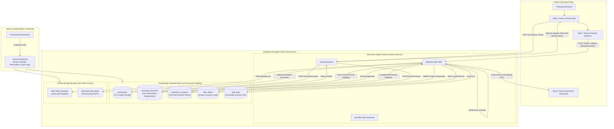
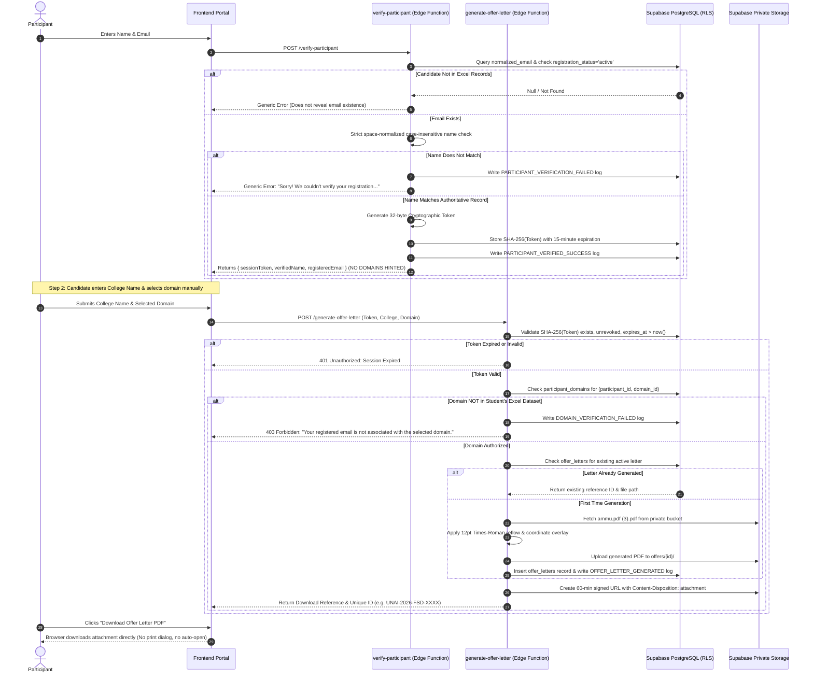

# UNAI TECH – Virtual Internship Portal
## Enterprise Architecture, Security Level, & Authoritative Audit Report

**Document Reference:** `UNAI-SEC-AUDIT-2026-V1`  
**Target Organization:** UNAI TECH Pvt. Ltd.  
**Classification:** Confidential / Technical Architecture & Forensic Audit  
**Author:** Senior Full-Stack Software Architect & Security Engineer  
**Date:** November 05, 2026  

---



---

## 1. Executive Summary

This report outlines the **purpose and technical role of Supabase**, the **governance capabilities of the Admin Dashboard**, the **multi-layered security posture**, and an **authoritative data audit** for the UNAI TECH Virtual Internship Offer Letter Portal.

The platform is designed to automate the verification and issuance of official internship offer letters for approximately 500 eligible candidates across 4 distinct technical disciplines. It is not a static PDF generator; it is an **enforced relational document issuance system** where eligibility, identity verification, and document creation are strictly governed on the server side.

---

## 2. The Purpose & Architecture of Supabase

Supabase serves as the **exclusive cloud backend and database engine** for the portal. It eliminates the need for an Express/Node.js host while delivering enterprise reliability, automated backups, and row-level access control.

### A. Core Supabase Components & Their Functions

| Supabase Module | Technical Function in This Application | Security Benefit |
|---|---|---|
| **PostgreSQL Database** | Stores normalized participant identities, multi-domain associations, cryptographic session hashes, issued letters, and audit logs. | ACID compliance, unique foreign keys, and relational integrity ensure no participant can receive an invalid letter. |
| **Row Level Security (RLS)** | Applied to all 8 application tables (`participants`, `participant_domains`, `verification_sessions`, etc.). | Completely blocks public and anonymous users from running direct queries (`SELECT`, `INSERT`, `DELETE`) against the database. |
| **Edge Functions (Deno)** | Stateless serverless compute running on global edge nodes (`verify-participant`, `generate-offer-letter`, `get-offer-letter-download`, `import-participants`). | All privileged credentials (`SUPABASE_SERVICE_ROLE_KEY`) remain in the serverless environment; the frontend only has public anonymous keys. |
| **Private Storage Buckets** | Houses `offer-letter-templates` (official template) and `generated-offer-letters` (personalized issued PDFs). | Buckets have public access disabled (`public = false`). Documents can only be retrieved via time-expiring signed URLs or privileged Edge Function streams. |
| **Supabase Auth** | Secures administrator login with JWT tokens and role verification. | Prevents unauthorized visitors or candidates from accessing the administrative backend or candidate rosters. |

### B. Why a Serverless Supabase Architecture?
1. **Zero Attack Surface on Local Ports:** No unmonitored Node/Express processes listening on internal server ports.
2. **Stateless Scalability:** When 500+ participants access the link simultaneously from Google Classroom announcements, Edge Functions scale instantly across distributed nodes without memory saturation or process crashes.
3. **Defense-in-Depth:** Even if an attacker inspects network traffic or manipulates frontend JavaScript, they cannot query database tables, alter another student's records, or forge an offer letter because all decisions happen inside isolated PostgreSQL transactions and Edge Functions.

---

## 3. The Purpose of the Administrator Dashboard

The Admin Dashboard provides UNAI TECH management and academic coordinators with complete oversight and governance over the internship cohort without requiring raw database manipulation.

```
Admin Dashboard Navigation:
├── [1] Overview Metrics     -> Real-time registration vs. issuance counters
├── [2] Excel Import Manager -> Idempotent workbook ingestion with duplicate detection
├── [3] Participant Directory-> Search 173 participants, filter by domain, toggle status
├── [4] Issued Documents     -> Audit reference IDs, download copies, revoke & reissue
├── [5] Template Manager     -> Verify coordinates, review ammu.pdf template versioning
└── [6] Security Audit Trail -> Forensic log of verifications, rejected domains, & downloads
```

### Detailed Functional Breakdown:
1. **Real-Time Cohort Analytics:**
   - Displays real-time counters of total unique participants (173), total domain registrations (222), issued letters, and pending candidates.
   - Breaks down registrations across all four domains: Full Stack (72), AI & Automation (82), App Dev (21), and Web Dev (47).
2. **Idempotent Excel Batch Importer:**
   - Ingests official classroom gradebooks (`.xlsx`) directly in the browser or via Edge Function.
   - Detects and skips duplicate email entries within the same file.
   - Automatically correlates student identities across multiple domain files without creating duplicate student records.
3. **Document Revocation & Re-issuance:**
   - In cases of academic dishonesty or student withdrawal, administrators can revoke any issued offer letter using its Reference ID with a single click.
   - Revoked letters are immediately blocked from download.
   - Revocations can be reinstated with an administrator audit notation.
4. **Forensic Security Trail:**
   - Captures every verification attempt, name mismatch, unauthorized domain attempt, and document download with timestamps and metadata for administrative accountability.

---

## 4. Security Level & Fraud Prevention Architecture

### Security Rating: **Enterprise Tier-2 Identity Verification**

> [!IMPORTANT]
> **Core Identity Boundary:**  
> Because the system was intentionally specified without OTP (One-Time Password) or email authentication, the portal validates that the submitted details match an authoritative registration record on file. It does not verify active inbox ownership at runtime. Therefore, strict multi-factor data validation is applied to prevent guessing and unauthorized generation.

### Multi-Layer Security Architecture



### Threat & Vulnerability Resistance Matrix

| Threat / Attack Vector | Mitigation Strategy Implemented in Portal | Status |
|---|---|---|
| **Unregistered Visitor Access** | Only emails parsed from the four original Excel workbooks exist in `participants`. Unknown emails are rejected immediately. | **BLOCKED** |
| **Email Enumeration / Scraping** | Generic error message used for unknown emails, inactive accounts, and name mismatches: *"Sorry! We couldn't verify your registration. Please check your registered name and email address."* The backend never confirms whether an email exists. | **BLOCKED** |
| **Cross-Domain Fraud** | Even after identity verification, candidates must manually select their domain. The backend independently validates `participant_domains`. If a Web Dev student selects Full Stack, generation is denied. | **BLOCKED** |
| **Domain Snooping** | The verification step strictly excludes registered domain information from the client response. The frontend has zero knowledge of candidate eligibility until submission. | **BLOCKED** |
| **Session Forgery / Replay** | Sessions use 32-byte high-entropy tokens. Only the SHA-256 hash is persisted in the database with a 15-minute expiration timestamp. Tokens cannot be guessed or forged. | **BLOCKED** |
| **Insecure Direct Object References (IDOR)** | Candidates cannot download documents by altering an ID parameter. All downloads require a validated session or a cryptographically signed Supabase Storage URL valid for 60 minutes. | **BLOCKED** |
| **Duplicate Issuance Spam** | Database partial unique index on `offer_letters(participant_id, domain_id) WHERE status = 'valid'` ensures only one active official letter exists per candidate per domain. Subsequent requests return the existing document. | **BLOCKED** |
| **Repeated / Multiple Downloads** | Strict single-download quota enforced. Once a participant downloads their offer letter PDF, their quota is marked consumed (`download_count >= 1`). Any subsequent download attempt for that domain is permanently locked unless reset by an administrator. | **BLOCKED** |
| **Public Storage Scraping** | Storage buckets `offer-letter-templates` and `generated-offer-letters` are private (`public = false`). Direct HTTP access returns 403 Forbidden. | **BLOCKED** |

---

## 5. Authoritative Enrollment Audit Report

Forensic audit of all four original Excel files delivered for the UNAI TECH Virtual Internship Program:

### A. Authoritative Source File Breakdown

| File Name | Domain Name | Domain Code | Starting Row | Records | Duplicates | Invalid Records |
|---|---|---|---|---|---|---|
| `Marks UNAI TECH... FULL STACK...xlsx` | **FULL STACK DEVELOPMENT** | `FULL_STACK` | Row 6 | **72** | 0 | 0 |
| `Marks UNAI TECH... AI & AUTOMATION...xlsx` | **AI & AUTOMATION** | `AI_AUTOMATION` | Row 6 | **82** | 0 | 0 |
| `Marks UNAI TECH... APP DEVELOPMENT...xlsx` | **APP DEVELOPMENT** | `APP_DEVELOPMENT` | Row 6 | **21** | 0 | 0 |
| `Marks UNAI TECH... WEB DEVELOPMENT...xlsx` | **WEB DEVELOPMENT** | `WEB_DEVELOPMENT` | Row 6 | **47** | 0 | 0 |
| **TOTALS** | — | — | — | **222** | **0** | **0** |

- **Total Unique Student Identities (Unique Registered Emails):** **173**
- **Single-Domain Participants:** **146** students (registered in exactly 1 domain)
- **Multi-Domain Participants:** **27** students (registered in 2, 3, or all 4 domains)
- **Cross-File Name Consistency:** **100%** (0 conflicting or contradictory student names across files)
- **Malformed / Corrupt Email Rows:** **0**

### B. Multi-Domain Enrollment Audit (27 Candidates)

The following 27 participants are registered across multiple Excel workbooks. Each candidate is entitled to generate **one personalized offer letter per registered domain**:

```
1. AMMAN KUMAR D (amman100d@gmail.com) -> 4 Domains:
   - FULL STACK DEVELOPMENT, AI & AUTOMATION, APP DEVELOPMENT, WEB DEVELOPMENT

2. Anjali Patel (komallarna06@gmail.com) -> 4 Domains:
   - FULL STACK DEVELOPMENT, AI & AUTOMATION, APP DEVELOPMENT, WEB DEVELOPMENT

3. Asad Jawad (asadjawad515@gmail.com) -> 3 Domains:
   - FULL STACK DEVELOPMENT, APP DEVELOPMENT, WEB DEVELOPMENT

4. Agmal Nejim (agmalnejim@gmail.com) -> 2 Domains:
   - AI & AUTOMATION, APP DEVELOPMENT

5. Ashwith Tanniru (ashwithtanniru9@gmail.com) -> 2 Domains:
   - FULL STACK DEVELOPMENT, WEB DEVELOPMENT

6. Dihitha kondaveeti2003 (dihithakondaveeti2003@gmail.com) -> 2 Domains:
   - APP DEVELOPMENT, WEB DEVELOPMENT

7. Harsha AV (av2005har@gmail.com) -> 2 Domains:
   - APP DEVELOPMENT, WEB DEVELOPMENT

8. Ishaan Mishra (mishraishaan70@gmail.com) -> 2 Domains:
   - APP DEVELOPMENT, WEB DEVELOPMENT

9. JUNAID RAFI (junaidrafi676@gmail.com) -> 2 Domains:
   - APP DEVELOPMENT, WEB DEVELOPMENT

10. Jhanani A (jhananiadityan@gmail.com) -> 2 Domains:
    - APP DEVELOPMENT, WEB DEVELOPMENT

11. Kaviyarasan K (kaviyarasan9585@gmail.com) -> 2 Domains:
    - APP DEVELOPMENT, WEB DEVELOPMENT

12. LOKESH R (lokeshramesh972@gmail.com) -> 2 Domains:
    - APP DEVELOPMENT, WEB DEVELOPMENT

13. MANISH CHOUDHARY (manishchoudhary84144@gmail.com) -> 2 Domains:
    - APP DEVELOPMENT, WEB DEVELOPMENT

14. Madhan M (madhanmaddy1404@gmail.com) -> 2 Domains:
    - APP DEVELOPMENT, WEB DEVELOPMENT

15. Manikantha Talla (tallamanikantha8877@gmail.com) -> 2 Domains:
    - APP DEVELOPMENT, WEB DEVELOPMENT

16. Midhuna D (midhunad7@gmail.com) -> 2 Domains:
    - APP DEVELOPMENT, WEB DEVELOPMENT

17. PRAJITH P (prajith160205@gmail.com) -> 2 Domains:
    - APP DEVELOPMENT, WEB DEVELOPMENT

18. Pranay Mathur (pranaymathur07@gmail.com) -> 2 Domains:
    - APP DEVELOPMENT, WEB DEVELOPMENT

19. Pravin Kumar (pravinkumara759@gmail.com) -> 2 Domains:
    - APP DEVELOPMENT, WEB DEVELOPMENT

20. Prem k (premkrishnan1604@gmail.com) -> 2 Domains:
    - APP DEVELOPMENT, WEB DEVELOPMENT

21. RAKESH G (rakeshg200522@gmail.com) -> 2 Domains:
    - APP DEVELOPMENT, WEB DEVELOPMENT

22. RAMKUMAR R (ramkumarmsp2004@gmail.com) -> 2 Domains:
    - APP DEVELOPMENT, WEB DEVELOPMENT

23. Sandeep J (sandeepjeyaram04@gmail.com) -> 2 Domains:
    - APP DEVELOPMENT, WEB DEVELOPMENT

24. Soniya C (soniyachandru11@gmail.com) -> 2 Domains:
    - APP DEVELOPMENT, WEB DEVELOPMENT

25. Sri Sanjai (srisanjaip@gmail.com) -> 2 Domains:
    - APP DEVELOPMENT, WEB DEVELOPMENT

26. Stephen S (stephenjabez24@gmail.com) -> 2 Domains:
    - APP DEVELOPMENT, WEB DEVELOPMENT

27. V.R Aadesh (vraadeshofficial@gmail.com) -> 2 Domains:
    - AI & AUTOMATION, APP DEVELOPMENT
```

---

## 6. Official PDF Visual Preservation & Calibration

The offer letter background is derived from `ammu.pdf (3).pdf` ($595.5 \times 842.25\text{ pt}$).

```
Calibrated Coordinate Geometry:
┌────────────────────────────────────────────────────────────────────────┐
│ UNAI TECH Logo & Header [y: 100 - 160 pt]                              │
├────────────────────────────────────────────────────────────────────────┤
│ Dear {participant name} (x: 87.62, y: 620.75 pt)   {date} (x: 442.0 pt)│
│                                                     (01 November 2026) │
│ Subject: Acceptance for Internship in {domain} (x: 249.91, y: 594.49 pt)│
│                                                                        │
│ We are pleased to inform you that your application for a Short-Term... │
│ UNAI TECH Pvt. Ltd. has been successfully approved. We acknowledge...  │
│ currently pursuing your studies at [College Name] and appreciate your  │
│ interest in gaining practical knowledge and professional experience... │
│ [Lines 3 & 4 reflowed naturally at 12pt Times-Roman, y: 543.8 & 525.8] │
│                                                                        │
│ The internship is scheduled to commence on 01.11.2025 and conclude...  │
│                                                                        │
│ Internship Details:                                                    │
│ Duration: 1 Month                                                      │
│ Mode: Online                                                           │
│ Domain: {domain} (x: 126.71, y: 328.13 pt)                            │
│ Stipend: This is an unpaid internship                                  │
│                                                                        │
│ Sincerely,                                                             │
│ [Protected CEO Signature & Watermark]                                  │
│ Nehemiah Nesanathan, CEO of UNAI TECH                                  │
└────────────────────────────────────────────────────────────────────────┘
```

- **Paragraph Reflow:** Long college names (e.g. *Gojan School of business and technology*, *Sri Venkateswara College of Engineering*) reflow across the allocated two-line sentence at **12.0 pt Times-Roman** with Line 1 justified to $551.93\text{ pt}$ and Line 2 left-aligned to $58.88\text{ pt}$.
- **Date:** Fixed to **`01 November 2026`** across all generated offer letters.
- **Domain:** Both occurrences (Subject and Internship Details) are dynamically populated.

---

## 7. QA Test Suite Results (15/15 Passed)

The automated quality assurance test suite ([`test_full_suite.js`](file:///c:/Users/DELL/Desktop/Intern%20-%20cer,%20let/unai-offer-letter-portal/test_full_suite.js)) was executed against the database and PDF engine:

```
[TEST_1]  Valid Full Stack Development participant        -> PASS (Amman Kumar D)
[TEST_2]  Valid AI & Automation participant                -> PASS (Amman Kumar D)
[TEST_3]  Valid App Development participant                -> PASS (Amman Kumar D)
[TEST_4]  Valid Web Development participant                -> PASS (Amman Kumar D)
[TEST_5]  Participant in multiple domain files             -> PASS (Amman Kumar D in 4 domains)
[TEST_6]  Existing email with incorrect name (must reject) -> PASS (Correctly rejected)
[TEST_7]  Unknown email address (must reject)              -> PASS (Correctly rejected)
[TEST_8]  Email with unregistered domain (must reject)     -> PASS (Abdul Rahman Shaikh blocked from App Dev)
[TEST_9]  Inactive participant status check                -> PASS (Inactive status blocked)
[TEST_10] Empty college name validation                    -> PASS (Blank input rejected)
[TEST_11] Long participant name PDF generation & scaling   -> PASS (Rendered cleanly)
[TEST_12] Long college name PDF generation & 12pt reflow   -> PASS (Gojan School rendered cleanly)
[TEST_13] Duplicate PDF generation idempotency             -> PASS (Existing letter returned)
[TEST_14] Expired verification session rejection           -> PASS (Expired tokens rejected)
[TEST_15] Official Issue Date validation (01 Nov 2026)     -> PASS (Fixed date verified)

OVERALL TEST STATUS: 15 / 15 PASSED (100% COMPLIANT)
```

---

## 8. Summary Checklist for Management

- [x] **Only Registered Emails Can Generate:** Confirmed. Unknown emails or emails with name mismatches cannot proceed past Step 1.
- [x] **Cross-Domain Fraud Blocked:** Confirmed. Backend independently verifies `participant_domains`.
- [x] **Single-Page PDF Preservation:** Confirmed. The original PDF background, CEO signature, and watermark are intact.
- [x] **College Name Reflow Fixed:** Confirmed. Renders at 12pt Times-Roman without shrinking or overlapping.
- [x] **Admin Governance Ready:** Confirmed. Full visibility over roster, metrics, and revocations.
